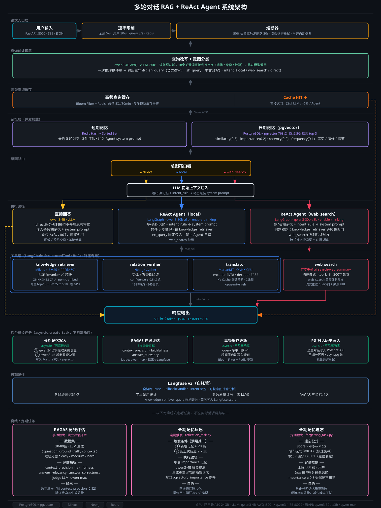

## 📖 项目简介

**ReAct Agent** + **Rag** 开发的**生产级多轮对话系统**，包含以下核心功能：

  - ReAct 多工具编排 / 多模型部署 / GraphRAG / 数据飞轮Agent / 并发压测 / MCP封装 / 前端页面等
    

  - 独立数据飞轮 Agent： https://github.com/Jkler879/WOW-Round3
  
  - 生产级并发压测： https://github.com/Jkler879/Wow-Production-Grade-Stress-Testing-Module


  **演示录频**：https://my.feishu.cn/wiki/MXPiwoSUoiXH8Rk6ytgcD0gvnbd
  
  **在线演示**：项目完整代码均已同步 Github，如需在线体验前端界面请提前告知（服务器非 7 * 24 小时运行）
  
  **Email_address** :  kemeng_work@outlook.com

## 🖼️ 架构图

<p align="center">
  <a href="https://Jkler879.github.io/Wow_Multi-turn-Dialogue-System/architecture.html" target="_blank" rel="noopener noreferrer">
    
  </a>
</p>

<p align="center"><sub>点击图片可放大观看（支持滚轮缩放、拖拽平移）</sub></p>

## ✨ 核心亮点

### 1、多轮对话与分层记忆
- **短期记忆**：`Redis` 热存储 + `PostgreSQL` 持久化 + 分层注入 + 摘要压缩
  | 模块 | 实现方式 |
  |---|---|
  | **热存储** | `Redis` 按 session_id 存储结构化会话状态 + 最近 12 轮对话原文，每轮对话自动续期，24 小时无对话 TTL 淘汰  |
  | **持久化** | `PostgreSQL` 存储全量对话数据（按月分区）+ 结构化会话状态；Redis 过期后自动读取 PG 中的会话状态与 12轮原文并写回 Redis，会话无缝衔接 |
  | **结构化会话状态** | 话题摘要、用户约束（会话级 / 话题级 / 本问级）、话题列表、实体表、事实三元组 |
  | **分层注入** | 用户提问后，会话状态注入系统提示词，近期原文注入消息历史，话题级与本问级约束拼在当前问题前 |
  | **Token 预算** | 短期记忆上限 3000 token，通常包含约 6–10轮历史对话原文 + 结构化会话状态；超出时先裁早期原文，生效约束永不裁剪 |
  | **后台异步压缩** | 对话满 10 轮或历史消息超过 70% 水位时，按话题递归生成摘要；轮数与 token双条件触发，避免短对话永远达不到水位而不压缩 |
  | **并发安全** | `Redis Lua` 单次往返原子读写 + 版本号 `CAS`，防止并发请求互相覆盖 |
  | **生产级恢复** | `AOF/RDB` 混合持久化 + `Docker` 数据卷挂载 + `PostgreSQL`全量对话存储，系统异常重启后短期记忆不丢失 |

      
- **长期记忆（跨会话）**：`PostgreSQL` + `pgvector` 存储，后台异步执行，不阻塞回答

  | 模块 | 实现方式 |
  |---|---|
  | **新记忆抽取** | 每轮回复后取完整问答对：代码先做前置过滤（原话里没有自称、也没有"记住"指令就跳过）→ `Qwen3-1.7B` 判断是否有高价值记忆，最多抽取3 条（事实 / 偏好 / 经历 + 重要性）→ 校验证据必须是用户原话；误存率 16% → 0% |
  | **新旧记忆合并** | 新记忆与该用户已有记忆比对，相似度 ≥ 0.78 的旧记忆（最多 3 条）交给 `Qwen3-4B`，输出新增 / 更新 / 删除 / 跳过的结构化决策，由代码在 `PostgreSQL` 事务中执行，不让 LLM 生成 SQL |
  | **长期记忆召回** | 用户提问后，`Qwen3-1.7B` 先判断问题是否需要个人背景，需要才检索；英文向量召回（相似度门槛 0.42，经标定）→ 按相似度、重要性、时效、频率加权重排，最多注入 3 条；每次被召回，访问次数 +1，提高后续排序 |
  | **遗忘（写入触发）** | 每次写入后检查单用户容量（200 条），超过上限按价值分（重要性 × 0.6 + 时效 × 0.3 + 频率 × 0.1）淘汰最低的记忆 |
  | **遗忘（分数衰减）** | 价值分随时间衰减，低于 0.1 的记忆失效（软删除） |
  | **反思（条件触发）** | 活跃记忆 ≥ 20 条或距上次反思 ≥ 7 天时触发：每类记忆取重要性 < 0.7 的最近 20 条，满 5 条由 `Qwen3-4B` 归纳为 1–3 条高层洞察，记录来源记忆可溯源 |


- **查询改写**：本地 `Qwen3-4B` 读取短期记忆（约 1400 token）+ `few-shot prompt`，输出 `JSON Schema` 约束的结构化结果

  | 模块 | 实现方式 |
  |---|---|
  | **指代消解与双语改写** | 把"它 / 他 / 刚才那个"等指代词还原为具体实体，生成独立的中文问句 + 英文检索问句（对齐英文知识库） |
  | **意图分类：direct** | 打招呼等简单问题降级为本地 4B 模型推理，跳过 ReAct Agent 推理 |
  | **意图分类：local** | 全链路执行 |
  | **意图分类：web_search** | 需时效性信息，全链路执行 + 定制化 System Prompt 意图注入 + 联网搜索工具调用 |
  | **题型分类：simple / reasoning** | 全链路执行 + 定制化 System Prompt 题型注入，步数上限 3 / 5 |
  | **题型分类：multi_hop** | 知识图谱预取 + 定制化 System Prompt 题型注入，步数上限 7 |

### 2、ReAct Agent 自主规划与工具调用

- **ReAct Agent 中枢**：`Qwen3.5-35B-A3B`（阿里云百炼 API）

| 模块 | 实现方式 |
|---|---|
| **选型原因** | MoE 架构，每次只激活 3B 参数。ReAct 每道题要调用模型 3–7 次，思考模式又会额外生成大量推理 token；激活参数少，单次调用的延迟和成本明显更低 |
| **配额与并发** | 百炼配额 RPM 600 / TPM 100 万，完整压测后单台 A10 服务器稳定支撑 30 个并发会话 |
| **Agent 框架** | `LangGraph` 实现 ReAct 循环（思考 → 行动 → 观察），工具调用全部采用原生 `Function Calling`，避免文本解析带来的格式错误与参数丢失 |
| **MCP 封装** | 对外暴露 3 个只读工具（知识库检索、图谱关系验证、完整 Agent 问答），令牌鉴权，供 Claude Code 等客户端远程调用 |

- **工具集**

| 工具 | 实现方式 |
|---|---|
| **知识库检索** | 向量 + BM25 双路召回 → 父段落 RRF 融合 → `bge-reranker-v2-m3` 重排 → 证据分级，按题型动态返回段落并附重排分数（详见第 3 节） |
| **实体关系验证** | 实体链接 + 参数化 `Cypher` 模板，在 `Neo4j` 中做 3 跳以内的路径查询 |
| **在线搜索** | 百度千帆搜索，结果经清洗与注入检测后再交给模型 |
| **翻译** | 本地 `Helsinki-NLP/opus-mt-en-zh`，把英文检索结果翻译为中文，支撑中文回复 |

### 3、检索系统深度优化

| 模块 | 实现方式 |
|---|---|
| **向量检索** | `Milvus 2.6` 新索引 `IVF_RABITQ`：RaBitQ 把 768 维 float32 向量量化为 1-bit 二进制码，内存降至原始的 1/32；`nlist=1024` 倒排聚类减少距离计算；`SQ8` 精排补回量化损失的精度 |
| **索引选型对比** | IVF 系列训练只需 k-means 聚类，远快于 HNSW 的逐点插入；HNSW 内存高 3–4 倍且构建慢；纯 IVF_FLAT 没有量化压缩，数据量大时延迟高 |
| **Milvus 优势** | 存算分离：增量更新时索引在专属资源池异步构建，不占用查询的 CPU 和内存；standalone 单机即可承载百万级向量，无需 GPU 或分布式集群，增量数据秒级可见 |
| **全文检索** | `Milvus 2.6` 原生 BM25：`sparse` 字段 + `BM25 Function` 实现全文检索，无需额外引入 Elasticsearch；向量与全文在同一个库里，没有双系统同步和数据不一致的问题 |
| **小块召回、大块返回** | 两路各召回 Top 30 个单句，命中句归并到所属父段落后做 RRF 融合（k=60），取 Top 25 个段落送入重排，最终返回完整段落上下文 |
| **MaxP 重排** | `TEI` 部署 `bge-reranker-v2-m3`（GPU，FP16），同一请求内为整段和命中单句打分，段落分取两者最大值，兼顾整体相关和局部精确匹配 |
| **证据分级与拒答** | 按重排 Top 1 分数分三档：≥ 0.3 高置信，直接作答并标注来源；0.1–0.3 低置信，由本地 4B 逐段判断能否回答，通过的提示"仅供参考"；< 0.1 无证据，明确拒答不编造 |
| **降级** | 重排服务失败时按 RRF 顺序取前 3 段；4B 判定不可用时低置信段落带"仅供参考"标记返回 |

### 4、数据预处理与知识图谱增强

| 模块 | 实现方式 |
|---|---|
| **本体建模** | 用 `OWL 2 / RDF` 定义 25 类实体、27 种关系及互斥约束；`SHACL` 校验规则和 `Neo4j` 约束都由本体自动生成；本体做版本化管理 |
| **版本化入库** | `Redis Stream` 消息队列入库，按 ID 幂等写入、失败重试、异常消息进死信队列 |
| **实体链接** | `Aho-Corasick` 词典做实体链接，别名覆盖中英文，弱别名单独处理，以图上连通性作为消歧依据 |
| **路径查询** | 参数化只读 `Cypher` 模板做 3 跳以内的路径查询，避免 LLM 生成 Cypher 带来的注入与语法错误 |
| **图增强检索** | 多跳题由代码强制执行图谱搜索，每条关系附带证据句并回链向量库切片；其他题型由 Agent 按需调用 |


### 5、本地模型量化与微调
- **模型量化**：

  **GPU 推理**（vLLM，OpenAI 兼容接口）

  | 模型 | 部署方式 | 量化方式 | 显存占用 | 说明 |
  |------|---------|---------|---------|------|
  | Qwen3-4B | vLLM 端口 8001 | AWQ int4 | ~8GB | 查询改写 / 意图分类器 /长期记忆新旧记忆比对 |
  | Qwen3-1.7B | vLLM 端口 8002 | AWQ int4 | ~3.2GB | 长期记忆新记忆提取：提取每轮问答对有价值的记忆 |
  | BGE-Reranker-v2-M3 | TEI | 原版FP32部署，TEI转FP16 | ~1.2GB | 检索后重排 |

  **CPU 推理**（ONNX Runtime，三个轻量模型）

  | 模型 | 量化方式 | 原始大小 | 量化后大小 | 压缩比 | 单次延迟 (p50) | 内存占用 |
  |------|---------|---------|-----------|--------|---------------|---------|
  | nomic-embed-text-v1 | ONNX导出 + INT8动态量化 | 523 MB | 132 MB | ↓75% | 13.9 ms | ~285 MB |
  | Helsinki-NLP/opus-mt-en-zh | ONNX 导出 + INT8 动态量化（encoder + decoder 分别量化） | 552 MB | 139 MB | ↓75% | 66.7 ms | ~256 MB |

- **部署**
    - 容器化：使用 `Docker Compose` 编排所有服务（Redis、Milvus、Neo4j、Ollama），实现一键启动完整环境，保证环境一致性。
    - API 服务：`FastAPI` 提供高并发异步接口，将长期记忆、摘要生成等模块异步化，不阻塞 Agent 主程序。

## 📚 知识库选型：Wizard of Wikipedia (英文数据集)
  本系统采用 Facebook AI 发布的 Wizard of Wikipedia (WoW) 数据集作为核心知识库。包含 22k+ 多轮对话（训练集 18k、验证集 2k、测试集 2k），共覆盖 1.3k+个维基百科主题。

**选型理由**：
  - 跨领域覆盖：主题涵盖历史、科技、艺术、娱乐等领域，考验系统在不同类型主题查询下的检索与生成能力。
  - RAG 基准：作为学术界和工业界广泛使用的 RAG 评估黄金基准。
  - 高轮次：单条数据平均`9.15轮`对话，考验系统在多轮对话中的短期记忆连贯性与指代消解能力。
  - 知识密集：单条数据平均 `750-1000 tokens` 的适中长度，考验模型的长上下文处理能力。

**预处理后数据集特征**：
  - 分块后平均轮次：`3.0轮`
  - 分块后平均大小：`724字符`
  - 分块后目标范围（800-1800字符）：`25.5%`数据落于目标范围内，`74.5%`数据小于目标范围（源数据本身包含大量短文本），无数据超过目标范围。
  - 每100条数据关系密度：经`NER抽取`和`RE抽取`后，`每100条数据总实体数量1917`，`总关系数345`，`18%关系密度`合理。

## 🛠️ 技术栈与选型理由

| 组件 | 选型 | 理由 |
|------|------|------|
| **Agent 框架** | LangGraph | 原生状态图编排，可精细控制"思考 - 行动 - 观察"循环，便于横向扩展工具、纵向扩展节点 |
| **ReAct Agent 模型** | Qwen3.5-35B-A3B（百炼 API） | MoE 架构，每次只激活 3B 参数。ReAct 每题调用模型 3–7 次，思考模式还会生成大量推理 token，激活参数少能明显降低延迟和成本，同样的 RPM / TPM 配额下支撑更多并发；原生 Function Calling 稳定。原用 Qwen3-30B-A3B，平台下线后切换 |
| **改写模型** | Qwen3-4B（本地 vLLM） | 参考查询改写主流选型（4–8B），实测对比 Qwen3-1.7B / 4B / 8B，4B 在精度与速度上最平衡；一次调用同时完成指代消解、双语改写、意图与题型分类 |
| **长期记忆模型** | Qwen3-1.7B / Qwen3-4B（本地 vLLM） | 参考 Mem0 的做法：记忆抽取和召回判断这类高频轻任务用 1.7B，新旧记忆的增删改决策用 4B，保证决策准确 |
| **模型服务** | vLLM + Hugging Face TEI | vLLM 在单卡 A10 上运行 4B / 1.7B 双实例；TEI 部署重排模型（GPU，FP16），三者共享一张卡 |
| **重排模型** | bge-reranker-v2-m3（TEI） | 主流开源重排模型，多语言、效果稳定；项目早期选型后沿用，Qwen3-Reranker 系列可作为后续升级方向 |
| **嵌入模型** | nomic-embed-text（本地 ONNX INT8） | 支持 `search_document` / `search_query` 前缀，英文检索表现好（知识库为英文数据集，参考 MTEB 榜单）；知识库、查询、长期记忆统一使用同一模型，保证向量空间一致 |
| **翻译模型** | Helsinki-NLP opus-mt-en-zh（本地 ONNX INT8） | 专业开源英译中模型，在过往项目中部署验证过精度和速度 |
| **模型量化** | ONNX Runtime | 比 Optimum 更底层，量化范围可定制；嵌入和翻译模型 INT8 量化后在 CPU 上推理 |
| **长期记忆存储** | PostgreSQL + pgvector | 记忆的结构化字段、向量检索和事务在同一个库里完成；早期用 LangMem 和 Mem0 开发，流程偏 Demo、过程不透明，重构为自研架构：写入门槛 + 4B 结构化决策 + 代码事务执行，不让 LLM 生成 SQL |
| **短期记忆与缓存** | Redis Stack | 内存数据库，低延迟；Lua 脚本单次往返原子读写会话状态；内置布隆过滤器支撑高频查询缓存，同时承载限流和熔断 |
| **对话历史** | PostgreSQL | 全量对话按月分区存储，幂等写入；同时保存会话状态快照，Redis 过期后从这里恢复 |
| **消息队列** | Redis Stream | 复用现有 Redis，轻量解耦知识库与知识图谱的异步入库，支持消费者组、重试和死信队列，避免引入 Kafka 重型组件 |
| **向量数据库** | Milvus 2.6 | `IVF_RABITQ` 新索引内存占用低、召回率高；`sparse` + `BM25 Function` 实现原生全文检索，避免额外引入 Elasticsearch，保证事务写入一致性 |
| **图数据库** | Neo4j | GraphRAG 主流选择，支撑知识图谱存储、实体关系验证和多跳路径查询 |
| **在线搜索** | 百度千帆 | 返回结构化摘要；结果经清洗和注入检测后再交给模型 |
| **API 服务** | FastAPI | 异步原生，SSE 流式输出；长期记忆、对话历史等写入在后台执行，不阻塞回答 |
| **监控与评估** | Langfuse + RAGAS | Langfuse 追踪每次请求的模型调用、工具步骤和 token 成本；RAGAS 做在线抽样与离线评估，驱动数据飞轮 |
| **部署** | Docker Compose | 13 个服务一键启动，健康检查控制启动顺序，按负载分配内存配额 |


## 🚀 后续优化方向
  - **推理引擎升级**：
      - 2、Qlora 微调 Qwen3-4b 模型，新增一轮飞轮验证查询改写、意图分类、题型分类的指标变化。
      - 3、基于当前服务器配置，将 Qwen3-30b-a3b api 替换为本地部署 Qwen3-14B int4 量化版，移除 API 费用。
      - 4、多 Agent 协作，改造原有 LangGraph 单 Agent 模式。
      - 5、添加K3S部署，替代原有Docker Compose。
 

## 📁 项目代码结构

```text
Wow_Multi-turn-Dialogue-System/
├── config/ - 配置
│   ├── config_path.py  # 集成配置管理
│   ├── paths.py  # 集成路径管理
│   └── redis_conf  # Redis 配置文件（bloom、内存管理、AOF/RDB等）
│
├── init/ - PostgreSQL 初始化脚本（容器首次启动自动执行）
│   ├── 01_schema_conversation.sql  # 主表：全量对话数据存储（ pg_partmen自动按月分区、冥等写入、敏感信息脱敏）
│   ├── 02_schema_vector.sql  # pgvector扩展（ HNSW向量索引 ）
│   └── 03_schema_long_term_memory.sql  # 长期记忆（memories主表 + user_profile用户画像）
│
├── ontology/ - 知识图谱本体建模（OWL 2 / RDF）
│   ├── wow_ontology.ttl  # 定义实体类型、关系与互斥约束
│   └── wow_shapes.ttl  # SHACL 校验规则
│
├── src/ - 核心源代码
│   ├── main.py  # 核心代码，全链路编排
│   ├── api.py  # FastAPI 异步服务入口（对话 / 会话 / 记忆 / 反馈 / 工具接口）
│   ├── eval_handler.py  # 飞轮评估专用接口
│   │
│   ├── web/ - 交互前端
│   │   ├── index.html  # SSE 流式展示推理过程、工具步骤与回答依据
│   │   └── static/  # Markdown 渲染、XSS 过滤
│   │
│   ├── mcp_server/ - MCP 服务
│   │   └── server.py  # 对外暴露 3 个只读工具（知识检索 / 图谱验证 / 完整 Agent 问答），令牌鉴权
│   │
│   └── core/
│       ├── auth.py  # 登录认证（bcrypt + JWT）
│       ├── session_store.py  # 会话软删除
│       ├── feedback.py  # 用户点赞 / 点踩，回流数据飞轮
│       ├── resilience.py  # 过载保护（准入控制、舱壁隔离）
│       ├── reasoning_chat.py  # 支持原生思考过程的 ChatOpenAI 扩展（百炼主模型）
│       ├── vllm_client.py  # 本地 vLLM 
│       │
│       ├── query_rewrite/ - 查询改写
│       │   ├── query_rewriter.py  # 指代消解、中英双语改写、意图与题型分类
│       │   └── query_rewrite_test_case.py  # 模块测试用例
│       │
│       ├── high_frequency_query_cache/ - 限流、熔断、高频查询缓存
│       │   ├── redis_bloom.py  # 高频查询缓存
│       │   ├── rate_limiter.py  # 三级令牌桶限流
│       │   ├── circuit_breaker.py  # 滑动窗口熔断器
│       │   └── redis_bloom_test_case.py  # 模块测试用例
│       │
│       ├── memory_short/ - 短期记忆（Redis 热存储 + PostgreSQL 快照）
│       │   ├── stm_service.py  # 短期记忆服务入口
│       │   ├── session_state.py  # 结构化会话状态（约束 / 话题 / 摘要 / 实体 / 事实三元组）
│       │   ├── context_builder.py  # 按 token 预算分层组装上下文（改写器 / Agent）
│       │   ├── compactor.py  # 后台异步压缩
│       │   ├── redis_short_memory.py  # Redis 存储（Lua 原子读写 + 版本号 CAS）
│       │   ├── session_store_pg.py  # 会话状态 PG 快照与恢复
│       │   └── stm_test.py  # 模块测试用例（34项）
│       │
│       ├── memory_long/ - 长期记忆（PostgreSQL + pgvector）
│       │   ├── long_term_memory.py  # 长期记忆检索、新记忆抽取、新旧记忆合并决策、PGvector 事务写入
│       │   ├── recall_gate.py  # 长期记忆召回判断
│       │   ├── forgetting_task.py  # 长期记忆遗忘（每日定时脚本）
│       │   ├── reflection_task.py  # 长期记忆反思（每日定时脚本 + 条件触发）
│       │   └── ltm_write_gate_test.py  # 模块测试用例
│       │
│       ├── conversation_data_postgresql/ - 全量对话历史
│       │   └── conversation_data.py  # asyncpg 连接池、分区表、指数退避重试
│       │
│       ├── ReAct_Agent/ - Agent 开发
│       │   └── tools/ - 工具集
│       │       ├── agent.py  # Agent 图构建与节点（LangGraph）
│       │       ├── base.py  # 工具工厂
│       │       ├── retriever.py  # 检索工具：混合检索 + RRF 融合 + MaxP 重排 + 证据分级
│       │       ├── relation_verifier.py  # 实体关系验证工具（知识图谱）
│       │       ├── translate.py  # 翻译工具
│       │       └── web_search.py  # 在线搜索工具（含安全注入防护）
│       │
│       ├── kg/ - 知识图谱
│       │   ├── linker.py  # 实体链接（Aho-Corasick 词典 + 消歧）
│       │   └── ontology.py  # 本体加载，生成校验规则与 Neo4j 约束
│       │
│       ├── security/ - 安全管控
│       │   ├── context.py  # 请求安全上下文（用户 / 会话 / 角色）
│       │   ├── pii.py  # 可逆脱敏
│       │   ├── injection.py  # 注入检测
│       │   └── events.py  # 安全事件审计
│       │
│       ├── evaluation/ - 在线评估
│       │   └── ragas_evaluator.py  # 按采样率异步评估，结果回写 Langfuse
│       │
│       ├── postprocess/ - 回答后处理
│       │   └── detectors.py  # 规则检测器
│       │
│       ├── embedder/ - embedding 推理
│       │   └── onnx_embedder.py  
│       │
│       ├── redis-stream/ - 消息队列异步入库
│       │   ├── producer.py  # 生产者：知识库数据推送至 Redis Stream
│       │   ├── producer_kg.py  # 生产者：知识图谱数据推送至 Redis Stream
│       │   ├── consumer_milvus.py  # 消费者：写入 Milvus
│       │   ├── consumer_neo4j.py  # 消费者：写入 Neo4j
│       │   ├── create_milvus_collection.py  # 创建 Milvus 知识库集合及索引（初始化运行一次）
│       │   ├── long_memory_collection.py  # 创建 pgvector 长期记忆集合及索引（初始化运行一次）
│       │   ├── migrate_milvus.py  # Milvus 集合迁移（新增 BM25 全文检索）
│       │   └── migrate_milvus_test.py  # 迁移测试
│       │
│       └── chunking/ - 数据预处理（文档分块 + 元数据注入 + NER抽取 + RE抽取）
│
├── scripts/ - 评测、标定、知识库构建与运维脚本
│
├── models/ - 本地模型（大文件不上传）
├── data/ - 源数据（大文件不上传）
├── .env.example - 环境变量模板
├── .gitignore - Git 忽略文件
├── .dockerignore - Docker 构建忽略文件
├── docker-compose.yml - Docker Compose 编排文件（ 13 个异构服务一键部署，按负责分配内存配额）
├── Dockerfile - 应用镜像构建文件（分层构建，代码更新秒级重建容器）
├── requirements.txt - Python 依赖列表
└── README.md - 项目说明文档
```
